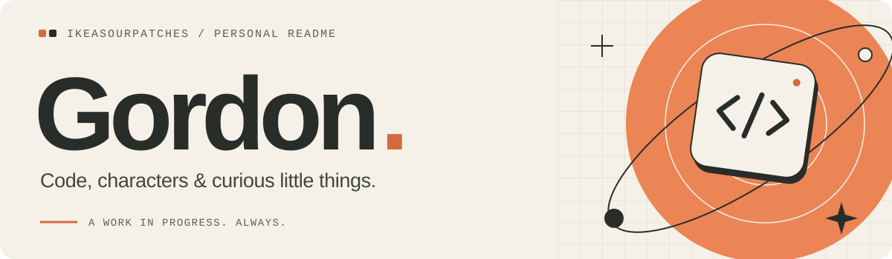
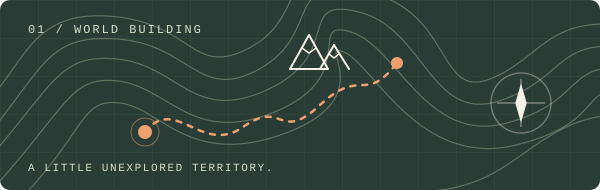
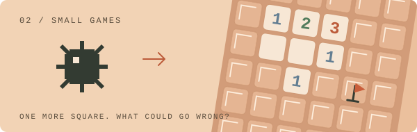
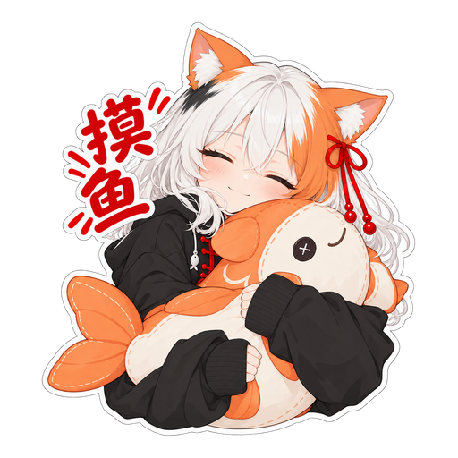
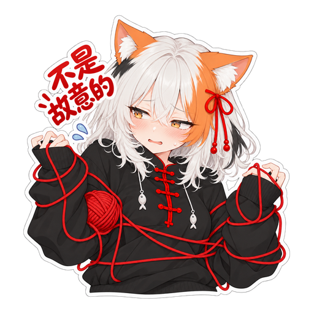
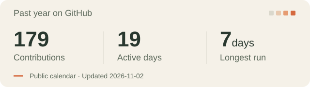

  

# Hey, I'm Gordon.

Student at **Singapore American School**. Competitive programmer, builder of strange little things, and occasional worldbuilder.

**Current quests**

- **Writing C++** and training for USACO Bronze.
- **Experimenting with AI**, image generation, and whatever catches my eye.
- **Bringing String to life** — my calico catgirl OC, with four sticker packs live on WeChat and a Live2D model.

### Tools on my desk

  &nbsp;
  &nbsp;
  &nbsp;
  &nbsp;
  &nbsp;
  

C++ for practice; React, TypeScript, Vite, and Python/Django in the [wiki](https://github.com/IkeaSourPatches/quoderat-wiki). Learning by making things.

## A few things I've made

<table>
  <tr>
    <td width="50%" valign="top">
      
      <h3><a href="https://quoderat.org">Quoderat</a></h3>
      
A bilingual <b>EN / 中文</b> wiki for a fictional world. Worldbuilding, one page at a time.

      
<a href="https://quoderat.org">Explore the wiki →</a>

    </td>
    <td width="50%" valign="top">
      
      <h3><a href="https://ikeasourpatches.github.io/minesweeper/">Minesweeper</a></h3>
      
The classic <b>10 × 10</b> game, in one HTML file. Small enough to keep simple. Still enough room to click a mine.
      
<a href="https://ikeasourpatches.github.io/minesweeper/">Play a round →</a>

    </td>
  </tr>
</table>

## Away from the keyboard

Usually GMing **D&D** or **SWADE**, doing **Model UN**, or somewhere in **Stellaris** and **Genshin**. Apparently, building fictional worlds wasn't enough; I have to spend time in other people's, too.

| Game (server) | Name | UID |
| --- | --- | --- |
| Genshin Impact (Asia) | IkeaSourPatch | 880058952 |
| Honkai: Star Rail (Asia) | IkeaSourPatch | 830806147 |
| Honkai Impact 3rd (SEA) | IkeaSourPatches | 24131371 |

  
<b>Recently forked, no explanation given.</b>

   

  

  - [mesh-avatar-studio](https://github.com/IkeaSourPatches/mesh-avatar-studio): okay, one explanation. [My PR got merged](https://github.com/shinshin86/mesh-avatar-studio/pull/78), and String's eyes use it.
  - [better-usaco](https://github.com/IkeaSourPatches/better-usaco): also [merged](https://github.com/YianXie/better-usaco/pull/1). It remembers your submission language now.
  - [claude-code-video-toolkit](https://github.com/IkeaSourPatches/claude-code-video-toolkit): no explanation.

## A little progress 

<a href="https://github.com/IkeaSourPatches?tab=overview#year-list-container">
  <picture>
    <source media="(max-width: 600px)" srcset="assets/activity-mobile.svg" />
    
  </picture>
</a>

From GitHub's public contribution calendar. Refreshed weekly. [Full activity →](https://github.com/IkeaSourPatches?tab=overview#year-list-container)

---

  <b>Have a strange little idea?</b> I'd like to hear it. 
  <a href="mailto:gordonji.contact@gmail.com">gordonji.contact@gmail.com</a>

  Inspired by <a href="https://github.com/YianXie/yianxie">Yian's profile</a>. Different worlds, same rabbit holes.

